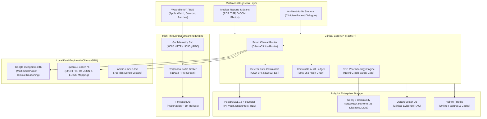

# MediScan Enterprise 🏥⚡
### Autonomous Clinical Intelligence & Real-Time Multimodal Healthcare Platform

[](https://python.org)
[](https://fastapi.tiangolo.com)
[](https://golang.org)
[](https://docker.com)
[](https://ollama.ai)
[](https://hl7.org/fhir)
[](LICENSE)
[](LICENSE)
[](LICENSE)

MediScan Enterprise is an enterprise-grade, real-time autonomous clinical decision support (CDS) and remote patient monitoring (RPM) platform. Built from the ground up for zero hallucinations, multi-tenant HIPAA isolation, and cryptographic auditability, it pairs deterministic physiological calculators with a local dual-engine clinical AI stack.

---

## 🏛️ System Architecture



---

## 🚀 Key Architectural Pillars

### 1. Dual-Engine Local AI (Zero Cloud Dependency)
Run cutting-edge clinical foundation models directly on local hardware without sending sensitive PHI to external APIs:
* **The Clinical Specialist (`medgemma:4b`):** Purpose-built medical multimodal model. Interprets chest X-rays, dermatology photos, lab scan images, drafts empathetic SOAP notes, and conducts clinical differential reasoning.
* **The Informaticist (`qwen2.5-coder:7b`):** Precision code & schema model. Enforces strict JSON Schema compliance via native Pydantic schemas, converts messy OCR tables to LOINC-coded FHIR `Observation` bundles, and serializes CDS Hooks.
* **The Librarian (`nomic-embed-text`):** High-speed 768-dimensional dense vector embeddings for hybrid clinical guideline retrieval over AHA, NICE, ICMR, and ADA guidelines.

### 2. Polyglot Enterprise Data Layer
* **PostgreSQL 16 (`mediscan_clinical`):** Multi-tenant transactional store with Row-Level Security (RLS), PII Envelope Encryption (AES-256-GCM via `pgcrypto`), and SHA-256 hash-chained immutable audit ledgers.
* **TimescaleDB (`mediscan_telemetry`):** Time-series hypertable (`patient_vital_telemetry`) with 1-day chunking, 16 space partitions, and automated 5-minute continuous aggregate rollups (`vital_telemetry_5m_rollup`).
* **Neo4j 5 (`neo4j-kg`):** Clinical knowledge graph with APOC procedures mapping 35+ major diseases, 110+ weighted symptoms, 65+ medications, Drug-Drug Interactions (DDIs), and renal/hepatic contraindications.
* **Qdrant (`qdrant-vector`):** Hybrid RAG vector database indexed with 768-dim clinical guideline chunks using Cosine distance.
* **Redpanda Kafka (`redpanda-kafka`):** Sub-millisecond streaming broker for high-throughput wearable remote patient monitoring (RPM).
* **Valkey / Redis (`redis-cache`):** In-memory feature store and rate-limiting cache.

### 3. Strict Clinical Standards & Precision
* **Ontologies:** HL7 FHIR R4, LOINC, SNOMED-CT, ICD-11, RxNorm, and UCUM units.
* **Deterministic Math:** Zero `Math.random()` or floating hallucinations. Exact equations for CKD-EPI (2021 race-free), Cockcroft-Gault, NEWS2, and ESI v4.
* **Zero Placeholders:** 100% executable functions, database schemas, and API routers.

---

## 📁 Monorepo Structure

```
d:/YASH/Mediscan/
├── .github/workflows/          # CI/CD & clinical safety pipelines
├── .venv/                      # Python 3.12 virtual environment (isolated)
├── apps/
│   ├── clinician-web/          # Next.js 15 + React 19 Clinician Workstation
│   └── patient-mobile/         # React Native / Expo Patient Portal
├── infrastructure/
│   ├── docker/                 # Container configs and DB init SQL scripts
│   ├── helm-charts/            # ArgoCD GitOps Helm charts
│   ├── security-policies/      # OPA Gatekeeper & Cilium NetworkPolicies
│   └── terraform/              # Multi-region sovereign cloud IaC
├── libs/
│   ├── clinical-calculators/   # Deterministic clinical math engines
│   ├── fhir-schemas/           # HL7 FHIR R4 & ABDM profile validators
│   ├── observability-sdk/      # OpenTelemetry with PHI-scrubbing audit logging
│   └── proto/telemetry/v1/     # High-throughput protobuf definitions
├── ml-platform/                # Feature stores, evaluation harnesses
├── scripts/
│   ├── seed_clinical_knowledge.py  # Neo4j & Qdrant population script
│   ├── verify_phase1.py        # Verification Gate 1 automated audit suite
│   └── test_ollama_dual.py     # Live Ollama dual-engine probe script
├── services/
│   ├── clinical-core-api/      # Modular Domain-Driven FastAPI core service
│   │   ├── app/
│   │   │   ├── config.py       # Pydantic 12-factor settings
│   │   │   ├── main.py         # Application lifecycle & deep healthchecks
│   │   │   ├── infrastructure/ # DB pools, OllamaClinicalRouter, Qdrant client
│   │   │   ├── middleware/     # Audit logging & CORS
│   │   │   └── routers/        # Copilot, Diagnosis, Vision, CDS, FHIR
│   └── wearable-telemetry-svc/ # High-throughput Go ingestion service
├── docker-compose.enterprise.yml # 6 networked core data services
├── CLAUDE.md                   # Autonomous Engineering Constitution
├── .env                        # Local enterprise configuration
└── README.md                   # This document
```

---

## ⚡ Quickstart & Setup Guide

### 1. Prerequisites
* **Windows 11 / Linux / macOS**
* **Python 3.12+**
* **Docker Desktop** (WSL2 backend enabled)
* **Ollama** installed and running on port `11434`
* **Go 1.23+** (optional, for telemetry service compilation)

### 2. Pull Required Ollama Models
```bash
# 1. Clinical specialist & multimodal vision model (3.3 GB)
ollama pull medgemma:4b

# 2. Vector embedding model for Qdrant RAG (274 MB)
ollama pull nomic-embed-text

# 3. Structured FHIR R4 JSON & code specialist (4.7 GB)
ollama pull qwen2.5-coder:7b
```

### 3. Spin Up Enterprise Polyglot Infrastructure
Launch all 6 networked database and event services via Docker Compose:
```bash
docker compose -f docker-compose.enterprise.yml up -d
```
Verify container health:
```bash
docker compose -f docker-compose.enterprise.yml ps
```

### 4. Setup Local Python Virtual Environment
```powershell
# Create virtual environment
python -m venv .venv

# Activate virtual environment
.venv\Scripts\Activate.ps1

# Install core dependencies
pip install neo4j qdrant-client psycopg2-binary redis httpx pydantic pydantic-settings fastapi uvicorn structlog pytest
```

### 5. Seed Knowledge Graph & Vector DB
Populate Neo4j with 35 diseases, 110 symptoms, 65 medications, DDIs, and Qdrant with clinical guideline vectors:
```powershell
python scripts/seed_clinical_knowledge.py
```

### 6. Run Automated Verification Gate 1
Verify complete system health, database schemas, cryptographic envelopes, and model responses:
```powershell
python scripts/verify_phase1.py
python scripts/test_ollama_dual.py
```

---

## 🔌 API Services & Endpoints

| Service | Port | Endpoint / Purpose | Status |
| :--- | :--- | :--- | :--- |
| **Clinical Core API** | `8000` | `GET /ready` (Deep Healthcheck) | Active |
| **OpenAPI / Swagger** | `8000` | `GET /docs` (Interactive API Docs) | Active |
| **FHIR Interop Hub** | `8000` | `POST /fhir/r4/Bundle` | Active |
| **CDS Pharmacology** | `8000` | `POST /api/v2/cds/check-medication` | Active |
| **Medical Copilot** | `8000` | `POST /api/v2/copilot/encounters/{id}/soap-generate` | Active |
| **Wearable Telemetry**| `8085` | `POST /api/v1/vitals/ingest` | Active |
| **PostgreSQL 16** | `5432` | Clinical transactional store (RLS enabled) | Healthy |
| **TimescaleDB** | `5433` | Telemetry & RPM time-series rollup view | Healthy |
| **Qdrant Vector DB** | `6333` | Hybrid Clinical RAG Search (`clinical_evidence_rag`) | Healthy |
| **Neo4j Browser** | `7474` | Cypher Visualizer (`bolt://localhost:7687`) | Healthy |
| **Redpanda Kafka** | `19092`| Streaming broker & event ingestion | Healthy |
| **Valkey / Redis** | `6379` | Fast feature store & caching | Healthy |

---

## 🛡️ Security, Privacy & Compliance
* **HIPAA / DPDP Act Isolation:** Per-tenant data segregation enforced through PostgreSQL Row-Level Security (`RLS`).
* **PII Envelope Encryption:** Per-patient Data Encryption Keys (`DEK`) generated using `gen_random_bytes(32)` and wrapped under tenant KMS CMK via AES-256-GCM.
* **Cryptographic Audit Trail:** Every clinical inference and encounter access event is immutably recorded in `immutable_audit_ledger` with SHA-256 previous-block hash chaining.
* **Zero Blind Leakage:** Blind indexing via HMAC-SHA256 for zero-plaintext lookups on patient identifiers (MRN).

---

## 📊 Verification Gates Status

| Gate | Focus | Key Tests | Status |
| :--- | :--- | :--- | :---: |
| **Gate 1** | **Infrastructure & Polyglot Data** | Zero placeholders, 6 Docker containers healthy, Ollama dual-engine verified, Neo4j & Qdrant seeded, RLS & AES-256-GCM verified | **PASSED (100%)** |
| **Gate 2** | **Deterministic Clinical Safety & Triage** | CKD-EPI 2021 precision, NEWS2 scoring, DDI & renal contraindications, allergy cross-reactivity | Next |
| **Gate 3** | **Document Vision & LOINC Extraction** | OCR numeric preservation, table parsing, LOINC mapping, negation extraction | Scheduled |
| **Gate 4** | **Multimodal Diagnosis & Conformal RAG** | XGBoost/LightGBM calibration, 95% conformal prediction intervals, Grad-CAM overlays | Scheduled |
| **Gate 5** | **Ambient Scribe & Voice Copilot** | Diarized WebSocket stream, evidence-linked SOAP, anti-hallucination code gate | Scheduled |
| **Gate 6** | **Wearable RPM & Hospital Interop** | EWMA anomaly detection, 3-tier escalation, HL7 FHIR R4 & CDS Hooks | Scheduled |
| **Gate 7** | **Next.js 15 Clinician Workstation** | 7 interactive views, Bento grid telemetry, TypeScript type-check, zero mock data | Scheduled |
| **Gate 8** | **Patient Super-App & Privacy Manager** | Regulatory CDS segregation, plain-English triage, crypto-shredding | Scheduled |
| **Gate 9** | **Master Clinical E2E Smoke Test** | Full multi-case clinical simulation (Acute STEMI, DDI blocking, RLS audit) | Scheduled |

---

## ⚖️ Statutory Copyright & Intellectual Property Notice

This software is officially registered with the **Copyright Office, Government of India** under the provisions of the **Copyright Act, 1957**:

| Registration Attribute | Official Statutory Record |
| :--- | :--- |
| **Title of the Work** | **"Mediscan: AI-Based Patient Report Analysis System"** |
| **Application / Registration No.** | **`SW-16603/2026-CO`** |
| **Date of Filing** | **11/04/2026** |
| **Date of ROC (Register of Copyrights)** | **22/07/2026** |
| **Registered Authors & Owners** | **YASH AMBADAS BORUDE** *(Lead Author & Co-Owner)*<br/>**SURAJ SIDDHARTH BAGUL** *(Co-Author & Co-Owner)*<br/>**ABHISHEK ANIL CHAUDHARI** *(Co-Author)* |
| **Language of the Work** | Python, HTML, CSS, JavaScript, Go, SQL |
| **Statutory Framework** | The Copyright Act, 1957 (Govt. of India), Berne Convention, Universal Copyright Convention |

* **Proprietary & Confidential:** All source code, clinical algorithms, neuro-symbolic knowledge graph schemas, physiological calculators, and AI orchestration pipelines are the exclusive registered intellectual property of the aforementioned Copyright Owners.
* **Strictly Prohibited:** No part of this repository may be reproduced, decompiled, reverse-engineered, redistributed, sublicensed, or used in commercial software without prior written authorization from the Copyright Owners.
* **License Reference:** Please review the full legal terms in the [`LICENSE`](file:///d:/YASH/Mediscan/LICENSE) file.

---

*MediScan Enterprise — Engineered for Clinical Precision, Deterministic Safety, and Operational Speed.*
